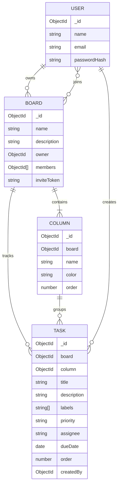

# TaskFlow

TaskFlow is a collaborative Kanban workspace with a React 18 + Vite + Tailwind client, an Express/Mongoose API, JWT authentication in an HTTP-only cookie, and board-scoped Socket.IO updates. Guests can explore and edit a sample workspace saved in browser storage; signing in enables persistent boards and live collaboration.

## Requirements

- Node.js 20.19+ (the Vite 8 development server requirement)
- npm
- MongoDB Atlas, or a local MongoDB replica set. Board creation, board/column deletion, and task moves/reordering use MongoDB transactions, so a standalone MongoDB server is not sufficient.

## Run locally

1. Install dependencies:

   ```sh
   npm install
   ```

2. Create `server/.env` from `server/.env.example` and configure `MONGODB_URI` and a strong, unique `JWT_SECRET`.
3. (Optional) Create `client/.env.local` from `client/.env.example`. The default API URL is `http://localhost:5000`.
4. Start the API and web app in separate terminals:

   ```sh
   npm run dev:server
   ```

   ```sh
   npm run dev:client
   ```

5. Open the Vite URL, create an account, and open the same shared board in another browser or signed-in account to verify real-time updates. The share button copies an invitation link; recipients sign in or create an account to join.

The client remains usable in local demo mode when the API is unavailable. Demo-mode changes are stored in that browser only and are not sent to the server.

## Environment variables

### API (`server/.env`)

| Variable | Required | Description |
| --- | --- | --- |
| `MONGODB_URI` | Yes for persistence | MongoDB connection string. Use a replica-set/Atlas URI for transactions. |
| `JWT_SECRET` | Yes in production | Long, random signing key; never commit or expose it. |
| `PORT` | No | API port; defaults to `5000`. |
| `CLIENT_URL` | No | Allowed client origin(s), comma-separated; defaults to `http://localhost:5173`. |
| `NODE_ENV` | No | Set to `production` for secure, cross-site cookies. |

### Client (`client/.env.local`)

| Variable | Required | Description |
| --- | --- | --- |
| `VITE_API_URL` | No | Public API origin; defaults to `http://localhost:5000`. |

## Deployment

Deploy the client and API as separate services:

- **Vercel:** set the project root to `client`, use `npm install` / `npm run build`, and set the output directory to `dist`. Set `VITE_API_URL` to the public Render API origin.
- **Render:** create a Node web service rooted at `server`, use `npm install` to build and `npm start` to start. Configure `MONGODB_URI`, `JWT_SECRET`, `NODE_ENV=production`, and `CLIENT_URL` with the Vercel site origin (including any preview origin that should be allowed).
- Configure Atlas network access for the Render service. Since the client and API use cross-site cookies, serve both over HTTPS in production.

Do not commit `.env` files, database URLs, or signing keys. The example files contain placeholders only.

## API overview

All `/api` routes except registration, login, and logout require the signed `taskflow_token` HTTP-only cookie.

| Method | Route | Purpose |
| --- | --- | --- |
| `POST` | `/api/auth/register` | Register and sign in |
| `POST` | `/api/auth/login` | Sign in |
| `GET` | `/api/auth/me` | Read the signed-in account |
| `POST` | `/api/auth/logout` | Clear the authentication cookie |
| `GET`, `POST` | `/api/boards` | List or create boards |
| `GET`, `PATCH`, `DELETE` | `/api/boards/:boardId` | Read, update, or delete a board |
| `POST` | `/api/boards/:boardId/columns` | Create a column |
| `POST` | `/api/boards/join/:inviteToken` | Join from a share invitation |
| `PATCH`, `DELETE` | `/api/columns/:columnId` | Rename or delete a column |
| `POST` | `/api/tasks` | Create a task |
| `PATCH`, `DELETE` | `/api/tasks/:taskId` | Update/move or delete a task |

Socket.IO clients authenticate with the same cookie, join only boards where they are members, and receive `board:update` and `board:presence` events in that board's room. The API broadcasts only after a successful database write.

## Data model



Column/task reordering and operations that cascade across a board or column use MongoDB transactions. Single-document writes remain atomic without opening a transaction.

## Checks

```sh
npm run lint
npm run build
npm test
```
